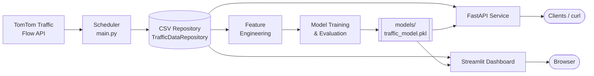
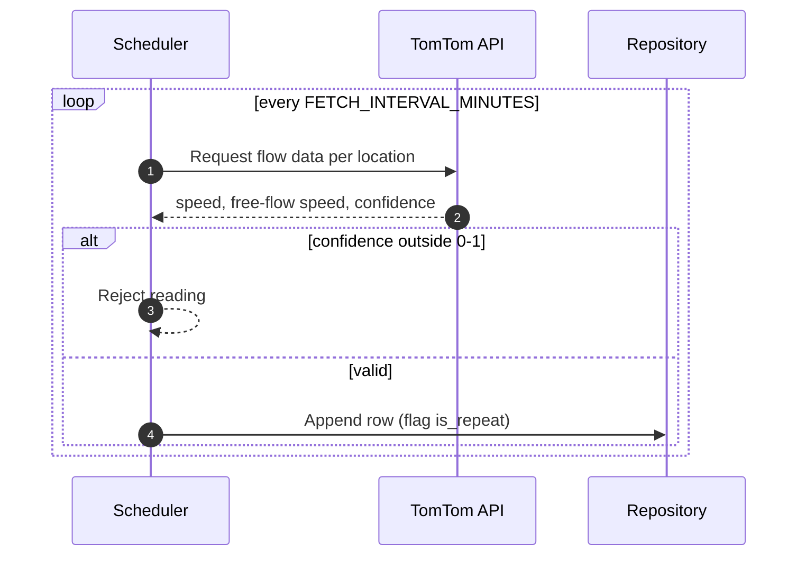
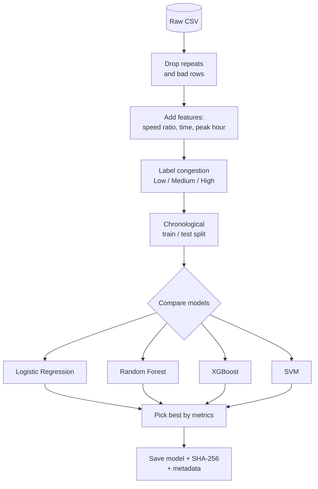
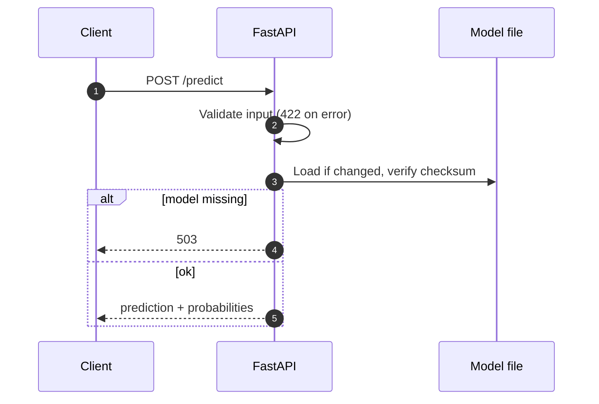

<div align="center">

# 🚦 Real-Time Traffic Congestion Prediction & Geospatial Analytics

**Collect live traffic data, predict congestion, and explore it on an interactive map.**

[](https://github.com/Shashwat-19/Real-Time-Traffic-Analysis/actions/workflows/ci.yml)
[](https://www.python.org/)
[](https://fastapi.tiangolo.com/)
[](https://streamlit.io/)
[](https://scikit-learn.org/)
[](https://xgboost.readthedocs.io/)
[](https://www.docker.com/)
[](https://github.com/astral-sh/ruff)
[](https://colab.research.google.com/github/Shashwat-19/Real-Time-Traffic-Analysis/blob/main/BangaloreTraffic.ipynb)

</div>

---

## 📖 Overview

This platform pulls live flow data from the **TomTom Traffic Flow API**, stores every observation as history, trains a congestion classifier (**Low / Medium / High**), and serves the results through a **FastAPI** service and a **Streamlit** dashboard with a Folium map.

Try it without installing anything: **[Open the Bangalore notebook in Colab](https://colab.research.google.com/github/Shashwat-19/Real-Time-Traffic-Analysis/blob/main/BangaloreTraffic.ipynb)**. It needs your own `TOMTOM_API_KEY`.

## 📑 Table of Contents

- [Features](#-features)
- [Architecture](#-architecture)
- [Workflows](#-workflows)
- [Tech Stack](#-tech-stack)
- [Getting Started](#-getting-started)
- [Usage](#-usage)
- [API Reference](#-api-reference)
- [Docker](#-docker-deployment)
- [Notebooks](#-notebooks)
- [Testing & Linting](#-testing--linting)
- [Project Structure](#-project-structure)
- [Roadmap](#-roadmap)

## ✨ Features

| Area | What you get |
|---|---|
| **Data collection** | TomTom Flow Segment Data integration. Readings with `confidence` outside 0–1 are rejected. A scheduler runs every `FETCH_INTERVAL_MINUTES` (default 10). |
| **Storage** | Append-only CSV through `TrafficDataRepository`. Repeated readings carry an `is_repeat` flag and are skipped in training and evaluation. |
| **Feature engineering** | Speed ratio, local-time fields (Asia/Kolkata), weekend and peak-hour flags, congestion labels. |
| **Modelling** | Logistic Regression, Random Forest, XGBoost and SVM compared on a chronological train/test split. The best model is persisted. |
| **Model safety** | `models/traffic_model.pkl` ships with a SHA-256 sidecar and a metadata file, both checked before loading. The API hot-reloads when they change. |
| **API** | FastAPI endpoints for health, latest traffic, history and prediction. |
| **Dashboard** | Streamlit with metrics, a Folium map of the latest reading per location, Plotly charts and a prediction form. |
| **Ops** | Docker Compose for API, dashboard and scheduler. GitHub Actions runs `ruff` and `pytest`. |

## 🏗 Architecture



All services depend on the repository boundary, so storage can move from CSV to PostgreSQL later with minimal changes.

## 🔄 Workflows

### Data collection



### Training pipeline



### Prediction request



## 🧰 Tech Stack

- **Backend:** Python 3.12 or 3.13 (3.14 fails to build pydantic-core), FastAPI, Uvicorn
- **Machine learning:** Pandas, NumPy, scikit-learn, XGBoost, Joblib
- **Visualization:** Folium, Plotly, Streamlit
- **Storage:** CSV now, repository pattern ready for PostgreSQL
- **Deployment:** Docker, Docker Compose, GitHub Actions

## 🚀 Getting Started

You need a free [TomTom API key](https://developer.tomtom.com/).

```bash
git clone https://github.com/Shashwat-19/Real-Time-Traffic-Analysis.git
cd Real-Time-Traffic-Analysis

python3.13 -m venv .venv
source .venv/bin/activate
pip install -r requirements.txt        # runtime only
pip install -r requirements-dev.txt    # adds pytest, ruff and httpx
cp .env.example .env
```

Edit `.env` and set `TOMTOM_API_KEY`. Never commit `.env`; it is in `.gitignore`.

`LOCATIONS` format:

```text
Location Name:latitude:longitude,Another Location:latitude:longitude
```

## 🕹 Usage

| Step | Command | Result |
|---|---|---|
| Collect one batch | `python main.py` | New rows in `data/` |
| Train a model | `python -m src.train` | `models/traffic_model.pkl` (needs enough history) |
| Run the API | `uvicorn api.main:app --reload` | Docs at <http://localhost:8000/docs> |
| Run the dashboard | `python -m streamlit run src/app.py` | App at <http://localhost:8501> |

> **Note:** plain `streamlit run src/app.py` fails with `ModuleNotFoundError: No module named 'src'` on the pinned Streamlit 1.41.1. Use `python -m streamlit run src/app.py`, or `PYTHONPATH=. streamlit run src/app.py`.

## 📡 API Reference

All traffic endpoints return JSON records. Rows with missing or non-numeric coordinates are left out, and empty values are returned as `null`.

| Method | Endpoint | Description |
|---|---|---|
| `GET` | `/health` | Service status and current UTC timestamp. |
| `GET` | `/traffic/latest?limit=20` | Newest observation per location, newest first. `limit` is 1–500. |
| `GET` | `/traffic/history?limit=100&since=<ISO 8601>` | Newest observations first. `limit` is 1–5000 (default 100). `since` without a timezone is read as UTC; an invalid value returns 422. |
| `POST` | `/predict` | Predict congestion for one reading. |

### `POST /predict`

Request:

```json
{
  "location_name": "New Delhi",
  "latitude": 28.6139,
  "longitude": 77.209,
  "current_speed": 25,
  "free_flow_speed": 55,
  "confidence": 0.9,
  "travel_time": 180,
  "timestamp": "2026-06-08T08:00:00+00:00"
}
```

`timestamp` is optional and defaults to now. Latitude must be between -90 and 90, longitude between -180 and 180.

Response:

```json
{
  "prediction": "Medium",
  "probabilities": { "High": 0.12, "Low": 0.18, "Medium": 0.70 },
  "features": {}
}
```

`features` holds only the model input columns.

| Status | Meaning |
|---|---|
| `422` | Invalid input: bad `timestamp`, out-of-range latitude, or missing/zero speeds. The body names the problem. |
| `503` | The model file is missing. Train the model first. |
| `500` | Unexpected error, including a checksum or metadata mismatch. Body is `{"detail": "Internal server error"}`; details are in the server log only. |

## 🐳 Docker Deployment

```bash
cp .env.example .env
docker compose up --build
```

| Service | Address | Notes |
|---|---|---|
| API | <http://127.0.0.1:8000> | Mounts `data/`, `models/`, `outputs/` read-only |
| Dashboard | <http://127.0.0.1:8501> | Mounts `data/`, `models/`, `outputs/` read-only |
| Scheduler | background | Writes to `data/`; the only service that reads `.env` |

- Ports are published on loopback only, so nothing is reachable from other machines. To expose them, change the `127.0.0.1:` prefix in `docker-compose.yml`, and add API authentication first.
- Containers run as user `app` (UID 1000). On Linux, make the host `data/` folder writable by that UID, for example `sudo chown -R 1000:1000 data`.

## 📓 Notebooks

| Notebook | Purpose | Colab |
|---|---|---|
| [`BangaloreTraffic.ipynb`](BangaloreTraffic.ipynb) | Collect and map Bangalore traffic. Installs missing packages itself. Does not read `.env`: set `TOMTOM_API_KEY` first. History is kept in `bangalore_traffic_data.csv`. | [](https://colab.research.google.com/github/Shashwat-19/Real-Time-Traffic-Analysis/blob/main/BangaloreTraffic.ipynb) |
| [`notebooks/EDA.ipynb`](notebooks/EDA.ipynb) | Exploratory analysis of collected data. Imports from `src/`, so clone the repo first. | [](https://colab.research.google.com/github/Shashwat-19/Real-Time-Traffic-Analysis/blob/main/notebooks/EDA.ipynb) |

## 🧪 Testing & Linting

```bash
pytest -q
ruff check .
```

CI runs both on every push and pull request.

## 🗂 Project Structure

```text
Real-Time-Traffic-Analysis/
├── .github/workflows/ci.yml
├── api/
│   └── main.py                  # FastAPI app
├── data/
│   ├── raw/
│   └── processed/
├── models/                      # traffic_model.pkl + sidecars
├── notebooks/
│   └── EDA.ipynb
├── outputs/
│   ├── maps/
│   ├── metrics/
│   └── reports/
├── src/
│   ├── app.py                   # Streamlit dashboard
│   ├── config.py
│   ├── data_fetcher.py          # TomTom client
│   ├── data_storage.py          # TrafficDataRepository
│   ├── evaluate.py
│   ├── feature_engineering.py
│   ├── map_generator.py
│   ├── model_artifacts.py       # checksum + metadata checks
│   ├── predict.py
│   ├── preprocessing.py
│   └── train.py
├── tests/
├── BangaloreTraffic.ipynb
├── Dockerfile
├── docker-compose.yml
├── main.py                      # scheduler entry point
├── pyproject.toml
├── requirements.txt
└── requirements-dev.txt
```

## 🗺 Roadmap

- [ ] Replace CSV storage with PostgreSQL and SQLAlchemy migrations
- [ ] Model registry and experiment tracking
- [ ] Authenticated API access
- [ ] Live dashboard refresh and API-triggered collection
- [ ] Geohash-based spatial aggregation
- [ ] Drift monitoring and automated retraining
